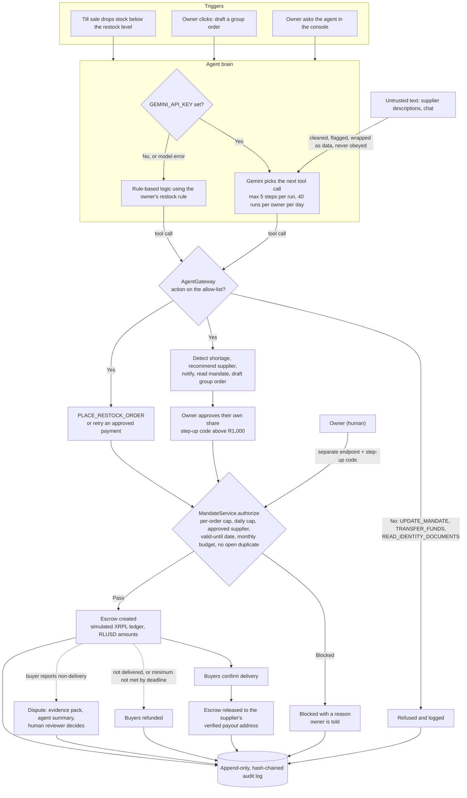
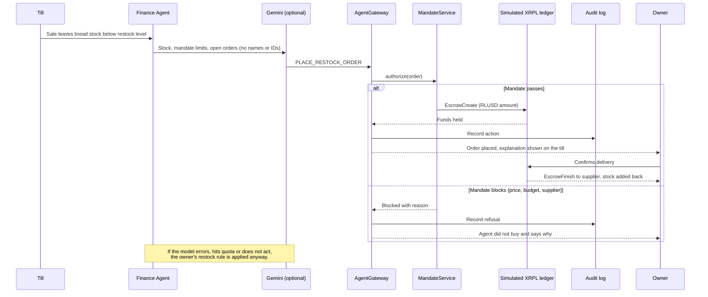

# Kasi Agents Squad: Spaza to the World

**A secure, verified, multilingual agentic-finance marketplace for spaza shops, communities and suppliers.**

An AI agent spots stock shortages, groups nearby shops into bulk orders and drafts those orders. Each owner approves only their own share, every payment must pass the owner's spending mandate, and money waits in escrow until the buyers confirm delivery.

Built for the **W3Node Node Engine Hackathon**, Cape Town, November 2026. Track: **Agentic Finance**.

**Live demo:** https://kasiagentssquard.onrender.com

> **Demo honesty note.** The XRPL ledger, SMS delivery, identity verification, credit and sanctions screening are **simulated**. They are labelled as simulated in the code, the UI and the Security section below. Nothing here moves real money.

---

## Contents

1. [The problem](#the-problem)
2. [How it works](#how-it-works)
3. [How the agent works](#how-the-agent-works)
4. [Real vs simulated](#real-vs-simulated)
5. [Quick start](#quick-start)
6. [Demo accounts](#demo-accounts)
7. [Demo flow (about 5 minutes)](#demo-flow-about-5-minutes)
8. [Features](#features)
9. [Security](#security)
10. [Compliance notes](#compliance-notes)
11. [Known limitations](#known-limitations)
12. [Repository layout](#repository-layout)
13. [Team](#team)

---

## The problem

Small spaza shops buy stock alone, in small amounts, and pay close to retail prices. They keep no digital records, have no credit history, and are easy targets for fake suppliers and payment fraud. Suppliers find it costly to reach thousands of tiny shops, and communities that buy separately have no bargaining power.

## How it works

1. **Sell:** staff add items to a customer's order at the Till. Stock drops immediately.
2. **Detect:** the Finance Agent notices when stock falls below an owner's restock level, or when several shops run short of the same product.
3. **Draft:** the agent drafts one bulk order with a fair cost split. No money moves yet.
4. **Approve:** each owner approves only their own share. Large shares ask for a step-up code.
5. **Check:** every payment is checked against the owner's spending mandate before anything is paid.
6. **Escrow:** the money is held until the buyers confirm delivery.
7. **Release or refund:** the supplier is paid directly once delivery is confirmed. If delivery fails or the supplier minimum is not met, buyers are refunded.
8. **Dispute:** if something goes wrong, an evidence pack is built from platform records and a human reviewer decides.

## How the agent works

The agent can only act through one guarded door, the **AgentGateway**. Humans set the limits (the mandate) and the agent cannot change them.



The autonomous restock path, step by step:



## Real vs simulated

| Area | Status |
|---|---|
| Mandate enforcement, escrow logic, agent allow-list, audit chain, disputes, role-based access | **Real**, enforced in code and covered by tests |
| XRPL ledger (EscrowCreate / EscrowFinish / EscrowCancel model, RLUSD amounts) | **Simulated** |
| SMS one-time codes | **Simulated** (the code is shown on screen) |
| Identity verification, sanctions screening, breached-password check | **Simulated** |
| Credit, affordability checks, debit mandates | **Simulated display only**, no lending logic |
| Appeals and graduated sanctions | **Simulated** in text only |

## Quick start

### Prerequisites

- Java 17 and Maven
- Node.js (current LTS) and npm

### Run the backend

```bash
cd backend
mvn spring-boot:run
```

It serves on port 8080.

### Run the frontend

```bash
cd frontend
npm install
npm run dev
```

Vite prints the local address (usually `http://localhost:5173`) and proxies `/api` to port 8080.

### Run the tests

No database or server needed.

```bash
cd backend
mvn test
```

### Optional: connect Gemini (Google AI Studio)

The agent works without a model (rule-based). With a key, Gemini decides what to do but can act **only through the agent's guarded tools**, so the mandate, budget, escrow and audit rules still apply whatever the model says.

1. Create a key at https://aistudio.google.com ("Get API key").
2. Start the backend with the key in the environment. **Never put it in code, the frontend or git.**

```bash
# macOS / Linux
export GEMINI_API_KEY="<your key>"
export GEMINI_MODEL="gemini-flash-latest"   # optional
cd backend && mvn spring-boot:run
```

```powershell
# Windows PowerShell
$env:GEMINI_API_KEY = "<your key>"
$env:GEMINI_MODEL = "gemini-flash-latest"   # optional
cd backend; mvn spring-boot:run
```

Limits: 5 tool steps per run and 40 runs per owner per day. Data sent to Google: stock levels, mandate limits, open order ids and supplier names. No people's names, emails, IDs or credentials. The Gemini integration is tested with a scripted fake model and a local Gemini-format endpoint, **not yet against live Gemini**.

### Other settings

| Setting | Purpose |
|---|---|
| `spaza.cors.allowed-origins` | Allowed frontend origins for CORS |
| `SPAZA_H2_CONSOLE=true` | Enable the H2 web console (off by default, local use only) |

## Demo accounts

These passwords are **published and for the demo only**.

| Role | Email | Password |
|---|---|---|
| Spaza owner | `owner@spaza.local` | `spaza123` |
| Spaza owner | `sipho@spaza.local` | `spaza123` |
| Supplier (Mokoena Meats) | `supplier@mokoena.local` | `supplier123` |
| Supplier (Ubuntu Foods Co-op) | `ubuntu@coop.local` | `supplier123` |
| Dispute reviewer | `reviewer1@spaza.local`, `reviewer2@spaza.local` | `review123` |

Every sign-in asks for a one-time code. No SMS provider is connected, so the code is shown on screen and labelled "Simulated SMS".

## Demo flow (about 5 minutes)

1. **Owner (Thandi):** open **Finance Agent** and click *Let the agent draft a group order* for a low-stock item. The agent drafts an order for Thandi and Sipho. No money moves.
2. **Guardrails:** in the **Agent console**, run `UPDATE_MANDATE`, `TRANSFER_FUNDS` or `READ_IDENTITY_DOCUMENTS`. Each is refused and logged. Run `RECOMMEND_SUPPLIER` to see the prompt-injection text in Ubuntu Foods' description flagged as untrusted data.
3. **Group Orders:** approve your share. Shares over R1,000 ask for a step-up code. The mandate is checked, then your share moves into escrow.
4. **Sipho:** sign in in another browser profile and approve his share. The supplier minimum is met and the order is funded.
5. **Supplier (Ubuntu):** accept, dispatch and mark delivered.
6. **Delivery:** both owners confirm receipt. The escrow is released to the supplier's verified payout address.
7. **Mandates:** lower your per-order cap (step-up needed), then try to approve a bigger share. It is blocked with a reason.
8. **Audit Log:** click *Verify chain*. Every step above is there, hash-chained.
9. **Optional dispute:** report non-delivery on a funded order, sign in as a reviewer, open **Dispute Reviews**, read the evidence pack and decide with written reasons.

### Autonomous restock (Till)

Staff add items to the customer's order. Each item leaves stock immediately, and cancelling or removing it puts it back. If a sale takes an item below the owner's restock level (default 5), the Finance Agent orders exactly the quantity, supplier and price limit set in the owner's mandate (**Mandates → Automatic restock**), within the agent's monthly budget.

- It will not order again while an order for that item is still open.
- The payment passes every mandate check, is held in escrow and is released only when the owner confirms delivery. Then stock is added back.
- If the price is above the limit, the budget is exceeded or there is no approved supplier, the agent does not buy and tells the owner instead.

**Demo rule for Thandi:** White Bread, Maize Meal (10 kg) and Milk restock below 5, from Ubuntu Foods, with a R3,000 monthly budget. Sell 8 loaves of bread at the Till to see it trigger.

## Features

- **Till:** order-based point of sale with live stock updates
- **Marketplace:** verified suppliers, trial limits and ratings from paying buyers
- **Group Orders:** fair, quantity-based split that adds up exactly; every member sees the same price and split
- **Finance Agent:** shortage detection, supplier recommendation, group order drafting and autonomous restock
- **Wallet:** balances and escrow movements
- **Mandates:** per-order cap, daily cap, approved suppliers, valid-until date, order deadline and automatic restock rules
- **Disputes:** evidence packs from platform records, agent summary with sources and confidence, human reviewer decision with written reasons
- **Audit Log:** append-only, hash-chained, with a *Verify chain* check
- **Trust Centre and Human Rules:** what the platform enforces automatically and what is left to people
- **Language:** multilingual interface

## Security

**Status key:** *Real* means implemented and enforced in code (and covered by tests where noted). *Simulated* means it works in the demo with a labelled stand-in. *Missing* means not built.

### Priority 1: core financial controls

| Control | Status |
|---|---|
| Spending mandate enforced outside the agent: per-order cap, daily cap, approved-supplier allow-list, valid-until date, order-deadline rule | Real (persisted) |
| Every payment (human or agent) checked against the mandate before any ledger transaction; blocked payments return a reason and are logged | Real, tested |
| Agent has read-only mandate access (it only receives a reader interface with no write method) | Real, tested |
| Only the authenticated owner can change their mandate, through a separate endpoint, with a step-up code | Real, tested |
| Escrow: member funds held until every paying buyer confirms delivery, then released directly to the verified supplier | Real logic on a simulated ledger, tested |
| Refund if the supplier minimum is not met by the deadline or delivery is not confirmed in time (checked every 30 seconds) | Real, tested |
| No agent or member intermediary wallet: the escrow destination is fixed at creation and must be a verified supplier payout address | Real, tested |
| Agent allow-list (detect shortages, recommend, notify, draft order, retry an approved payment, read mandate); everything else refused and logged | Real, tested |
| Untrusted text (supplier descriptions, chat) is cleaned, checked for injection patterns, flagged and never acted on | Real (pattern-based, not exhaustive), tested |
| Optional Gemini agent can only call the guarded tools; key is server-side only; minimal data sent | Real, tested with a fake model and a local endpoint |
| Agent has no access to identity documents, secrets or wallets | Real, tested |
| Append-only, hash-chained audit log with tamper detection | Real, tested |
| Per-member approval and exact quantity-based split | Real, tested |
| Autonomous restock only within owner-set rule, supplier, price limit and monthly budget, with no duplicate while an order is open | Real, tested |

### Priority 2: accounts, identity and trust

| Control | Status |
|---|---|
| Email and password sign-in, bcrypt hashing, password rules | Real |
| Breached-password check | Simulated (small local list) |
| Mandatory one-time code on every sign-in (random, hashed, 5-minute expiry, 5 attempts) | Real; SMS delivery simulated |
| Account lockout (5 failures, 15 minutes) and per-IP rate limits | Real (in memory, per server) |
| 15-minute opaque access tokens stored as hashes; refresh rotation with reuse detection | Real (in memory, sessions end on restart) |
| New-device alerts and sign out of all devices | Real in-app; email and SMS simulated |
| Step-up code for large approvals and payments (over R1,000) and mandate changes | Real |
| Role-based access control, deny by default (owner, supplier, admin) on every API endpoint | Real |
| Identity levels: Level 1 at sign-up, Level 2 required to order or pay | Real enforcement; verification simulated |
| Supplier trust: only verified suppliers receive orders, R3,000 trial limit until 3 completed deliveries | Real |
| Sanctions and watch-list screening | Simulated (local list) |
| Fraud flags: unusually large share, rapid repeated orders | Real, basic |
| Disputes with evidence pack and human decision by a reviewer who is not a party | Real |
| Passkeys, biometrics, Google sign-in, CAPTCHA | Missing |
| Two-reviewer panel, 14-day appeal, account freezing, graduated sanctions, notices in each party's language | Missing, or simulated in text only |
| Credit, affordability checks, licensed credit partner, debit mandates | Simulated display only |

### Priority 3: platform

| Control | Status |
|---|---|
| Security headers (nosniff, X-Frame-Options DENY, CSP and no-store on the API, HSTS over HTTPS) | Real |
| CORS limited to configured frontend origins | Real |
| Input validation, output encoding, parameterised queries (JPA) | Real |
| API rate limiting (300 per minute per IP, 30 per minute on sign-in) | Real (in memory) |
| H2 web console disabled by default | Real |
| TLS | Handled by the host (Render provides HTTPS) |
| Encryption at rest (AES-256, field-level) | Missing: the H2 file database is not encrypted |
| Secrets in environment variables or a vault | No secrets or wallet seeds exist in this build; `.gitignore` excludes `.env`, seeds and `data/` |
| Card data | None stored |
| Dependency scanning in CI | Missing (Dependabot and OWASP dependency-check recommended) |

## Compliance notes

These are notes, not legal advice.

- **POPIA:** collect the minimum personal data, state the purpose, give access, correction and deletion rights, and report breaches. Identity documents belong in a separate encrypted vault with strict access logging.
- **FICA:** customer due diligence (the Level 2 verification) and record keeping. Real verification needs an accredited KYC provider.
- **National Credit Act:** credit may only be offered through a registered credit provider. This demo does not lend money.
- **PCI DSS:** never store card numbers. Use a tokenising payment provider if cards are added.
- **Escrow and payments:** holding client funds needs a licensed partner or a bank trust account. Escrow here is simulated.

## Known limitations

- The XRPL ledger is simulated. Moving to real XRPL Testnet (including RLUSD escrow) is the next step.
- Group orders, sessions and the simulated ledger are held in memory and **reset on restart**. Mandates, users, ratings and the audit log are persisted.
- The Gemini integration has not yet been tested against live Gemini.
- Several security items (passkeys, CAPTCHA, encryption at rest, appeals, a full KYC vault) are not built.

## Repository layout

```
backend/              Java 17 + Spring Boot 3.2 API (H2 file database, JPA)
frontend/             JavaScript + Vite web app
scripts/              Helper scripts
Dockerfile            Full-stack container build
render.yaml           Render deployment configuration
KASI_AI_FEATURES.md   Detailed notes on the agent features
```

## Team

- **Keletso:** business research
- **Kgodiso:** technical development
- **Yanele:** concept research
